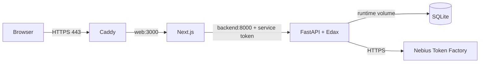

# Deploying on Google Cloud

One VM runs three containers: Caddy serves HTTPS and forwards to the Next.js app, which forwards API calls to the single-worker FastAPI backend. The backend image compiles Linux Edax v4.6 and downloads the Edax evaluation weights, so no local binaries are copied. SQLite lives in the `runtime` Docker volume.



## 1. Create the VM

Run in [Cloud Shell](https://shell.cloud.google.com) after selecting a project with billing (the free trial works):

```sh
gcloud services enable compute.googleapis.com
gcloud compute addresses create nemothello-ip --region=us-west1
gcloud compute instances create nemothello \
  --zone=us-west1-b --machine-type=e2-medium \
  --image-family=ubuntu-2404-lts-amd64 --image-project=ubuntu-os-cloud \
  --boot-disk-size=30GB --address=nemothello-ip --tags=web
gcloud compute firewall-rules create nemothello-web \
  --allow=tcp:80,tcp:443,udp:443 --target-tags=web
gcloud compute addresses describe nemothello-ip --region=us-west1 --format='value(address)'
```

The last command prints the static IP. Without your own domain, use `<ip-with-dashes>.sslip.io`, for example `34-82-10-20.sslip.io` for `34.82.10.20`. With a domain, add an A record pointing to the IP.

## 2. Install Docker and the code

```sh
gcloud compute ssh nemothello --zone=us-west1-b
sudo apt-get update && sudo apt-get install -y docker.io docker-compose-v2 git
git clone https://github.com/carrol74/nebius-othello.git
cd nebius-othello/deploy
```

## 3. Configure

```sh
cp .env.example .env
cp ../backend/.env.example backend.env
openssl rand -hex 32
nano .env
nano backend.env
```

In `.env`, set `DOMAIN`, `ACME_EMAIL`, and `BACKEND_SERVICE_TOKEN` (the random value printed above). In `backend.env`, set `TOKEN_FACTORY_API_KEY` and `TOKEN_FACTORY_MODEL_ID`. Compose supplies the service token, database path, and Edax paths, so leave those fields in `backend.env` empty.

## 4. Start

```sh
sudo docker compose up -d --build
sudo docker compose ps
sudo docker compose logs -f gateway
```

The first build compiles Edax and the web app. Caddy obtains the certificate within a minute; then open `https://<DOMAIN>`.

## 5. Check

```sh
sudo docker compose exec backend nemothello check-edax --output /app/runtime/edax-check.json
sudo docker compose exec backend nemothello verify-demo --url http://127.0.0.1:8000 --output /app/runtime/verify-demo.json
```

`verify-demo` plays a full game and calls Nemotron, so it uses Token Factory credits.

## Update

```sh
cd ~/nebius-othello && git pull && cd deploy && sudo docker compose up -d --build
```

Games, reviews, and certificates persist in Docker volumes across rebuilds.
